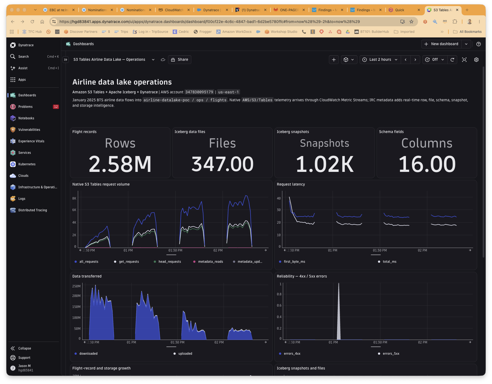
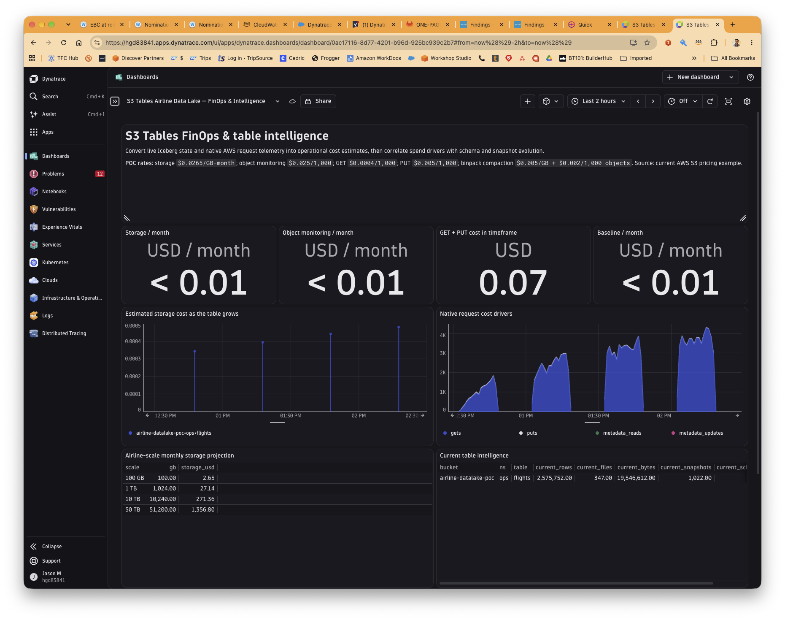
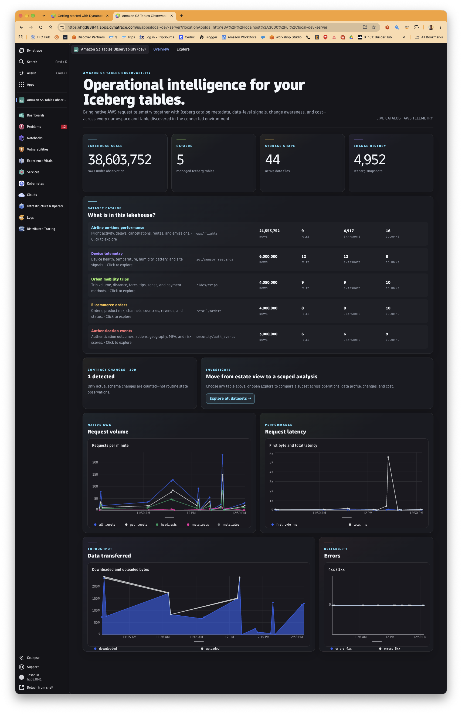
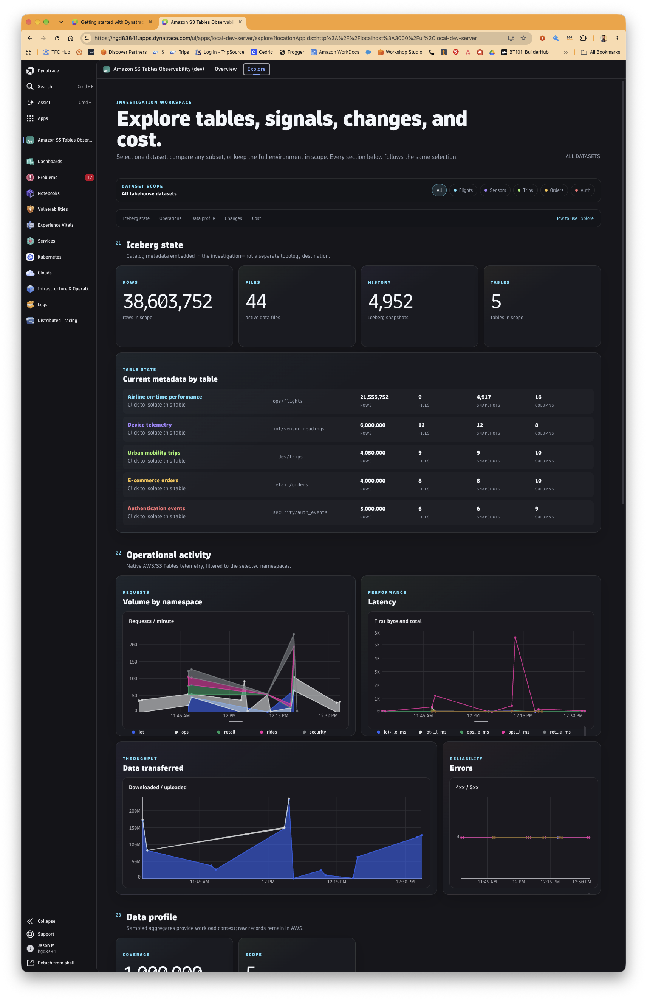

# Observing Amazon S3 Tables with Dynatrace

Amazon S3 Tables deliver fully managed Apache Iceberg storage for analytics at scale. As
organizations move lakehouse workloads onto S3 Tables, they need to answer two different
questions about them: *is the storage service healthy?* and *what is happening inside the
tables?* This project establishes, with a working proof of concept, exactly how much of
each question Dynatrace can answer today — and defines the integration Dynatrace should
build to answer the rest.

The POC is live in AWS account `347830095179`, Region `us-east-1`, using the US DOT BTS
Airline On-Time Performance dataset in a table named `airline-datalake-poc / ops / flights`.

---

## What exists today

Dynatrace observes Amazon S3 Tables through **AWS CloudWatch metrics ingestion** of the
`AWS/S3/Tables` namespace. These metrics launched in November 2025, and Dynatrace can
ingest them through either path of its AWS Cloud Platform Monitoring:

- **CloudWatch Metric Streams** — AWS streams metrics in near real time through Amazon Data
  Firehose to a Dynatrace ingest endpoint. Recommended for new connections.
- **Metric polling** — Dynatrace polls the CloudWatch API on an interval. Classic path.

Because Dynatrace can ingest any CloudWatch namespace, `AWS/S3/Tables` is available today.
The telemetry it carries is **operational and infrastructure-level**:

| Category | Metrics | Cadence / cost |
|---|---|---|
| **Storage** | Total bucket storage (bytes), total file count | Free, daily |
| **Maintenance** | `CompactionBytesProcessed`, `CompactionObjectsCount` | Free, daily |
| **Requests** | All / Get / Put / Head / Post request counts, metadata-location read & update counts, `BytesDownloaded`, `BytesUploaded`, `4xxErrors`, `5xxErrors`, `FirstByteLatency`, `TotalRequestLatency` | Opt-in per bucket, 1-minute, billed as custom metrics |

All of it splits by three dimensions: `TableBucketName`, `Namespace`, `TableName`. Once
ingested as timeseries, Dynatrace Intelligence applies baselining, anomaly detection, and
alerting on top. This is enough to run capacity planning, cost-trend analysis, maintenance
health, throughput and latency performance, and reliability alerting on the storage layer.

## Where the gaps are

CloudWatch metrics describe how the storage *service* behaves. They say nothing about the
Iceberg model living inside the tables. The following are not available through the metrics
path, by design:

- **Schema and schema-evolution history** — columns, types, and how they changed over time.
- **Snapshot history, partition specs, and row/file counts** from Iceberg table metadata.
- **Topology** — table bucket → namespace → table as first-class, navigable entities.
- **Correlation** — the ability to tie an operational symptom (a compaction storm, a
  latency spike, a cost jump) to the specific schema or table change that caused it.

These are data-plane facts that live in the Iceberg catalog, not in CloudWatch. Reaching
them requires connecting to the table's **Iceberg REST Catalog (IRC)** — either the S3
Tables IRC endpoint directly, or the AWS Glue IRC endpoint for customers standardized on
the Glue Data Catalog.

## What the POC demonstrates

The POC runs **two complementary telemetry planes against the same live table** and shows
them side by side in Dynatrace.

**1. The native operational plane (available today).** A dedicated CloudWatch Metric Stream
serializes the `AWS/S3/Tables` namespace as OpenTelemetry 1.0 and delivers it through
Amazon Data Firehose to the Dynatrace AWS metrics endpoint. The design is production-shaped:

- No cross-account Dynatrace IAM trust; all roles are in-account and least-privilege.
- The scoped ingest token never appears in source or CloudFormation — Firehose resolves it
  from AWS Secrets Manager at runtime.
- Failed-record delivery is backed up to S3 and the pipeline is self-observable via Firehose
  delivery metrics.

**2. The Iceberg intelligence plane (what the gap looks like filled in).** A collector reads
the S3 Tables IRC endpoint and publishes to Dynatrace what CloudWatch cannot: record counts,
data-file counts, current storage bytes, snapshot count and current snapshot, schema field
count, and explicit **schema-change events**.

With both planes flowing, the POC demonstrates the capability that matters: during the
workload the table schema evolved from 15 to 16 fields (adding `co2_estimate_kg`), and
Dynatrace captured that change as an event **correlated on the same dashboards** with table
growth, snapshot churn, maintenance, latency, and estimated cost. Two dashboards present it:
an **Operations** view and a **FinOps & Intelligence** view, the latter computing a live
storage-cost estimate from Iceberg state and reconciling it against the native daily
CloudWatch storage metric as that arrives.

Scale and fidelity are real, not illustrative: 1.3M+ rows across continuous scheduled
read/write workloads, ~20 ms average request latency, and zero 4xx/5xx errors in the
verification windows. Current operational state and exact resource names are in
[`STATUS.md`](STATUS.md).

## Dashboards

**Airline Data Lake — Operations.** Native `AWS/S3/Tables` request volume, latency, data
transferred, and 4xx/5xx reliability, presented alongside live Iceberg state — rows, data
files, snapshots, and schema field count — for the `airline-datalake-poc / ops / flights`
table.



**FinOps & Intelligence.** Live Iceberg state and native request telemetry converted into
operational cost estimates, with native request cost drivers, an airline-scale monthly
storage projection, and current per-table intelligence.



## What is missing — and what Dynatrace should build

The native integration is accurate and shippable, but it is shallow by nature: streamed
`AWS/S3/Tables` metrics arrive as generic metric keys with dimensions, not as a first-class
S3 Tables service with its own entity model. (For competitive context, Datadog has already
shipped a dedicated S3 Tables integration tile with named metrics and one-click enable;
a dedicated Dynatrace Hub tile does not yet appear to exist.)

The differentiated, net-new opportunity is an **IRC-based integration** that turns the
Iceberg catalog into Dynatrace topology and intelligence:

1. **First-class entities** for table bucket → namespace → table, so Smartscape and the
   entity model understand the lakehouse the way they understand hosts and services.
2. **Schema and snapshot model** — schema with evolution history, snapshot history,
   partition specs, and row/file counts pulled from Iceberg metadata.
3. **Correlation** — operational metrics (the plane that exists today) tied to the specific
   data-model change that drove them, so a schema change that triggers a compaction storm or
   a cost jump is one click away from its cause.
4. **Packaging** — a supported connector (S3 Tables IRC and/or Glue IRC, selected by
   configuration) with the one-click enablement customers expect.

The POC is the evidence that this gap is real and that the fill is tractable: plane two above
is a working prototype of exactly this integration.

## Architecture

```
Amazon S3 Tables (airline-datalake-poc / ops / flights)
   |
   |-- AWS/S3/Tables CloudWatch metrics
   |        -> CloudWatch Metric Stream (OTel 1.0)
   |        -> Amazon Data Firehose
   |        -> Dynatrace AWS metrics endpoint        [operational plane, ships today]
   |
   `-- Iceberg REST Catalog (IRC)
            -> IRC collector (schema / snapshots / storage / events)
            -> Dynatrace metric & event ingest       [intelligence plane, the Build target]
```

## Productized build — integration + app

The IRC prototype is now packaged into two Dynatrace-native deliverables, both built on a
shared collector and verified live (see [`integration/VERIFICATION.md`](integration/VERIFICATION.md)):

- **[`integration/`](integration/README.md)** — a **Dynatrace Extensions 2.0** extension
  (`custom:s3tables.iceberg`) that runs on an ActiveGate, polls the S3 Tables IRC, and
  reports the Iceberg metrics, schema-state/-change events, and table-bucket → namespace →
  table **topology**. Builds and signs to a deployable zip.
- **[`app/`](app/README.md)** — a **Dynatrace App** (dt-app App Toolkit) with two
  destinations: a customer-neutral Overview and a URL-scoped Explore workspace combining
  operations, data profile, schema changes/current contracts, and cost/capacity.
- **[`poc/s3tables_core.py`](poc/s3tables_core.py)** — the shared, hardened collector both
  build on.

Build, test, and deploy runbook: [`BUILD.md`](BUILD.md). End-user guide:
[`docs/app-user-guide.md`](docs/app-user-guide.md).

### App experience

**Overview** dynamically discovers the connected customer's tables and combines estate
KPIs, current Iceberg metadata, contract-change awareness, and native AWS telemetry.
Clicking any dataset opens a scoped investigation.



**Explore** keeps one dataset, any subset, or the full environment in scope while moving
through Iceberg state, operational activity, sampled data profile, actual schema changes,
and cost/capacity in one investigation flow.



## Repository layout

```
README.md                                   this document
ONE-PAGER.md                                executive summary
BLOG-DRAFT.md                               blog post draft
STATUS.md                                   live POC state and resource names
infra/                                      CloudFormation: S3 Tables, metric stream, loaders, dashboards
poc/                                        PyIceberg loader, load generator, IRC collector, schema evolution
dashboards/                                 Dynatrace Operations and FinOps dashboards
research/
  integration-patterns.md                   how the integration works today vs. the IRC build
  dynatrace-s3-tables-data-points.md         authoritative AWS/S3/Tables metric catalog
  competitive-datadog.md                     Datadog S3 Tables integration reference
```

## Summary

Operational observability of S3 Tables works in Dynatrace today through CloudWatch metrics,
and this project surfaces every data point it provides. The value Dynatrace does not yet
deliver — schema, topology, snapshot history, and the correlation between data-model change
and operational effect — requires an Iceberg REST Catalog integration. This POC runs both
planes against a live airline data lake to show precisely where today's capability ends and
what the next integration should be.
